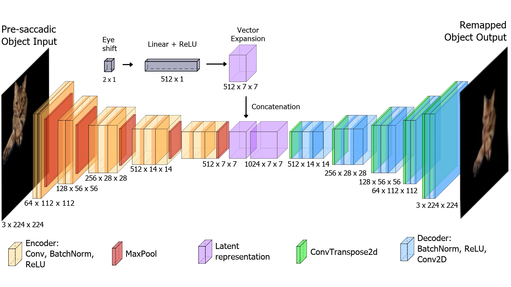
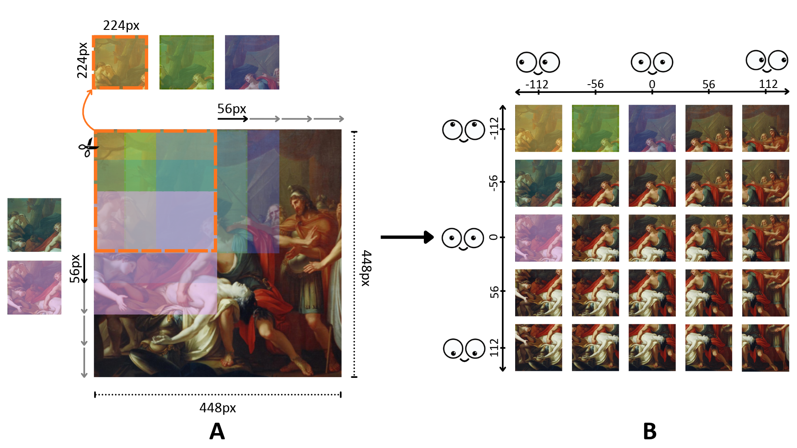
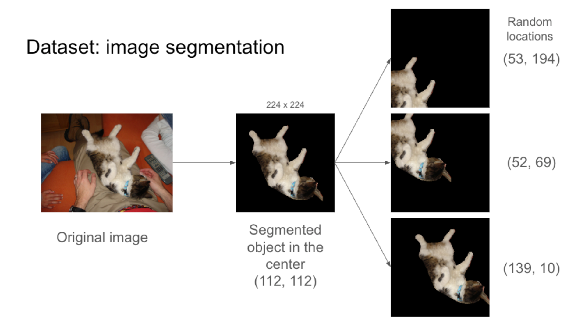

# Abstract
Whenever the eyes move, the locations of attended targets must be updated to keep track of them despite their shift on the retina, a process called remapping. Here we show that each attended target’s identity can be connected to the locations of its features in early visual cortex through a steerable autoencoder network. The network is trained to appropriately shift the feature activity to the target’s new location with each saccade. The model is a type of autoencoder architecture that takes an input pattern, here from early retinotopic cortex, passes it through several layers of encoding to generate a high-level, low-dimensional representation that corresponds to the object areas of visual cortex. The model receives and integrates the upcoming saccadic movement information (gain fields) in this layer. This then returns through decoding layers to project the target's feature activity to its expected post-saccadic location in early visual cortex. When there is no saccade, these downward projections provide the feedback to an object’s features in early visual cortex, boosting their activity to generate object-based attention. However, when there is an upcoming saccade, the feedback switches from the current target location to its predicted post-saccadic location, providing remapping. Autoencoders differ from the visual system in several ways involving learning rules and layer to layer feedback among other factors. Nevertheless, the results here demonstrate that feedforward-feedback loops can establish the link between target properties in early visual cortex and identity in the object areas of cortex and, importantly, maintain them even as the eyes move.

# Model Architecture
<p float="center">
  
  <br>
    <em> Autoencoder with eye movement vector injection at the latent space </em>
 </p>

# Install Anaconda + Set up conda environment 
This project uses **Conda** to manage its runtime environment, think of it as a sandbox for your software.  
Conda installation instruction can be found here (if you haven't installed):
```
https://www.anaconda.com/docs/getting-started/installation
```

To create a conda environment in the terminal:
```
conda create --name steerable-autoencoder python=3.11
```

To activate the newly created conda environment:
```
conda activate steerable-autoencoder
```

# Install required Python/Python packages 
Requirement: Python 3.11

To install required libraries:
```
pip install -r requirements.txt
```
*Note: Not all libraries are required, some are for attempted experiments and visualizations, feel free to remove the ones not needed. If not sure, just install them all.*

# Generate ImageNet Mini Pre-train Dataset
<p float="center">
  
</p>

In this project, we generate a dataset that represents definite eye movements of 56px by cropping overlapping images from ImageNet. We use ImageNet Mini since it's sufficient and no need for full ImageNet dataset.

Download ImageNet Mini from here:
```
https://www.kaggle.com/datasets/ifigotin/imagenetmini-1000
```
*ImageNet is also acceptable, just a bit overkill.*
Unzip and save in folder **\imageNet**
You should now have folder that looks something like this
```
$\imageNet\imagenet-mini
                    |──train
                            |──class1
                                |──xxxx.jpg
                                |──...
                            |──classN
                                |──xxxx.jpg
                                |──...
                    |──val
                            |──class1
                                |──xxxx.jpg
                                |──...
                            |──classN
                                |──xxxx.jpg
                                |──...
```

Generate Pre-train dataset from ImageMini
```
python imageNet/imageGenerator.py
```
*Note: To change whether generating train set or val dataset, change the variable **dataset***

# Generate black background dataset from COCO dataset
<p float="center">
  
</p>

For main training dataset, we generate a dataset with objects at random locations on black background from COCO dataset.  The name of the images are following this convention: *XYZ_Xcoordinate_Ycoordinate*.

In this project, we use COCO 2017 Train and Val images, along with 2017 Train/Val annotations.  
COCO dataset can be found here.
```
https://cocodataset.org/#download
```
Download, save and unzip in folder **coco/**.  
Folder **coco/** should now have following folders **train2017, val2017, annotations_trainval2017**.

To generate black background dataset:
```
python coco/objectCutter_black.py
```
*Note: To change whether generating train set or val dataset, change the variable **dataset_type** in file **python objectCutter_black.py***

# Generate list of training/validating sets
```shell
python vector/tools/generate_list.py --name trainCoco_black --path coco/trainCoco_black
python vector/tools/generate_list.py --name trainImageNet --path imageNet/trainImageNet
```

# Download no offset ImageNet pre-trained autoencoder weights (no eye movement)
Save it in **vector/results/imagenet-vgg16**
```
https://drive.google.com/file/d/1WwJiQ1kBcNCZ37F6PJ_0bIL0ZeU3_sV8/view?usp=sharing
```

# Pre-training with imageNet WITH eye movement vector
```shell
bash vector/run/train.sh {model architecture such as vgg16} {you dataset name}
# For example
bash vector/run/train.sh vgg16 trainImageNet
```

# Training with COCO WITH eye movement vector
Copy the latest checkpoint in **vector/results/trainImageNet-vgg16**.

Make a new directory in **vector/results/trainCoco_black-vgg16** and save the above checkpoint here.

Then run

```shell
bash vector/run/resume.sh {model architecture such as vgg16} {you dataset name}
# For example
bash vector/run/resume.sh vgg16 trainCoco_black
```

For fully trained steerable autoencoder weights
```shell
https://uwoca-my.sharepoint.com/:u:/g/personal/knguy52_uwo_ca/IQASHc682ceWQIAXKpco4GssAfqgnyMqbG3jDqKXWhFDFqw?e=lleRQY
```

p/s: if the link expires, please send me a message

# Visualize and evaluate trained model

To visualize
```shell
python vector/tools/reconstruct_recenter.py --resume {path to checkpoint} --val_list {path to test/valid file list} 
# For example
python vector/tools/reconstruct_recenter.py --resume vector/results/trainCoco_black-vgg16/001.pth --val_list vector/list/valCoco_black_list.txt 
```

To evaluate model
```shell
python vector/tools/steerable_autoencoder_evaluation.py --resume {path to checkpoint} --val_list {path to test/valid file list} 
# For example
python vector/tools/steerable_autoencoder_evaluation.py --resume vector/results/trainCoco_black-vgg16/001.pth --val_list vector/list/valCoco_black_list.txt 
```

# Source
This code is a modified version from original source code here: 
```shell
https://github.com/Horizon2333/imagenet-autoencoder
```